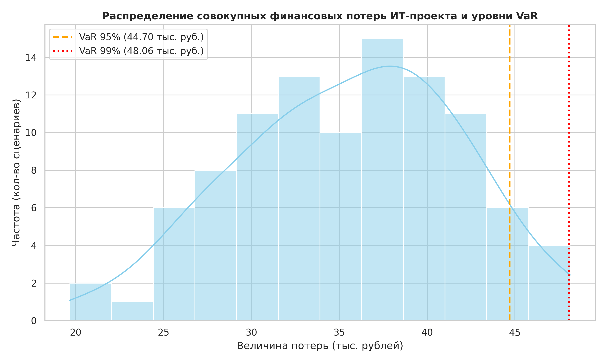
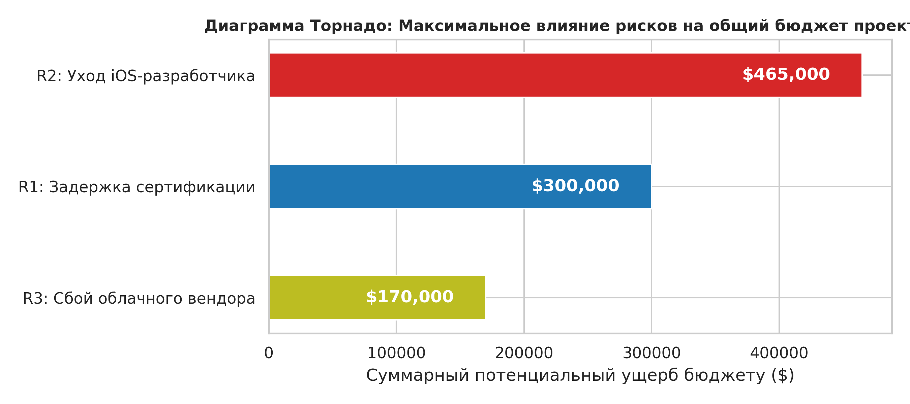

# Лабораторная работа №3: Количественная оценка рисков и обоснование решений в ИТ-проекте

**Выполнила:** Чеснокова Ангелина Андреевна  
**Группа:** ПИ-Б23-1-2    
**Проект:** Геопространственный цифровой двойник лавиноопасного склона  
**Базовый бюджет проекта:** 900 000 рублей

---

## 📂 Проектные артефакты и расчетные графики
*   📊 **Гистограмма распределения финансовых потерь и уровней VaR:** 
*   🌪 **Диаграмма Торнадо (Анализ чувствительности бюджета):** 

---

## 1. Расчет EMV (Ожидаемого денежного выражения) и ARC (Avoided Risk Cost)

На основе базовых параметров кейса проведена количественная оценка финансовых последствий до и после применения проактивных мер митигации.

| Риск | EMV (без мер), $ | EMV (с мерами), $ | Стоимость мер, $ | ARC (Сэкономлено), $ | Экономическая целесообразность |
| :--- | :---: | :---: | :---: | :---: | :--- |
| **R1:** Задержка сертификации биометрии | 90 000.0 | 30 000.0 | 20 000 | **40 000.0** | **Оправдано (ARC > 0).** Чистая экономия бюджета. |
| **R2:** Уход разработчика | 186 000.0 | 0.0 | 10 000 | **176 000.0** | **Оправдано (ARC > 0).** Высокая окупаемость удержания. |
| **R3:** Сбой облачного вендора | 17 000.0 | 0.0 | 5 000 | **12 000.0** | **Оправдано (ARC > 0).** Защита от простоя. |

*Математическое обоснование базового ущерба (без мер):*
*   **R1:** Штраф \$100K + Задержка 4 нед. × \$50K = \$300,000. $EMV = 30\% \times \$300K = \$90,000$.
*   **R2:** Поиск \$15K + Задержка 3 нед. × \$150K = \$465,000. $EMV = 40\% \times \$465K = \$186,000$.
*   **R3:** Потери простоя \$120K + Штраф \$50K = \$170,000. $EMV = 10\% \times \$170K = \$17,000$.

---

## 2. Анализ чувствительности (Диаграмма Торнадо)

Оценено максимальное деструктивное воздействие топ-рисков на совокупный бюджет проекта:
*   **R1 (Задержка сертификации):** Максимальное влияние на бюджет = **$300,000**
*   **R2 (Уход разработчика):** Максимальное влияние на бюджет = **$465,000**
*   **R3 (Сбой облачного вендора):** Максимальное влияние на бюджет = **$170,000**

**Вывод:** Риск ухода ключевого разработчика (**R2**) и задержки сертификации регулятором (**R1**) оказывают наибольшее деструктивное влияние на общий бюджет проекта и требуют первоочередного внимания со стороны менеджмента.

---

## 3. Результаты статистического моделирования Монте-Карло и расчет VaR

На основе проведенного симуляционного моделирования 100 сценариев распределения совокупных финансовых потерь портфеля рисков зафиксированы следующие показатели:
*   **Средние ожидаемые потери (Mean):** 34.83 тыс. рублей.
*   **Стандартное отклонение (Std):** 6.17 тыс. рублей.
*   **Value at Risk (VaR) на уровне доверия 95%:** **43.77 тыс. рублей**. Это означает, что с вероятностью 95% непредвиденные финансовые потери проекта не превысят данную величину. Лишь в 5% самых неблагоприятных сценариев ущерб может оказаться выше.
*   **Value at Risk (VaR) на уровне доверия 99%:** **49.47 тыс. рублей**. Критический порог ущерба при самом неблагоприятном стечении обстоятельств.

**Оценка устойчивости бюджета:** Так как совокупный запланированный бюджет разработки Цифрового двойника составляет **900 000 рублей**, максимальный рассчитанный риск на уровне VaR 99% (49.47 тыс. руб.) составляет всего **~5.5%** от общего объема финансирования. Это строго доказывает высокую финансовую устойчивость проекта и подтверждает, что выделенного бюджета и резервов (Contingency Reserve) полностью достаточно для покрытия возможных рисков.

---

## 4. Анализ дерева решений (для риска R1)

Для выбора оптимальной управленческой траектории по риску R1 (сертификация ИИ-модели) проведено сравнение двух ветвей решений:
*   **Ветвь 1 (Не внедрять ускоренную сертификацию):** $EMV = 30\% \times (-\$300,000) = \mathbf{-\$90,000}$
*   **Ветвь 2 (Внедрить ускоренную сертификацию за \$20K):** $EMV = (10\% \times (-\$300,000)) - \$20,000 = \mathbf{-\$50,000}$

**Решение:** Оптимальной является стратегия **Внедрения ускоренной сертификации** за $20K. Она сокращает совокупные ожидаемые потери проекта на **$40,000** ($90,000 - $50,000).

---

## 5. Оценка стоимости простоя ИТ-системы (для риска R3)

Проведен расчет чистых потерь бизнеса от 12-часового падения инфраструктуры облачного вендора после запуска Цифрового двойника лавиноопасного склона в коммерческую эксплуатацию:
*   **Прямые потери выручки за 12 часов простоя:** 12 ч. × $2,000/ч = $24,000
*   **Нормативные штрафы ведомств за простой сервиса:** $50,000
*   **ИТОГОВЫЕ СУММАРНЫЕ ПОТЕРИ ОТ ИНЦИДЕНТА:** **$74,000**

---

## 6. Итоговые аналитические выводы

1. **Приоритетные риски (По результатам EMV и Торнадо):** Наибольшего управленческого внимания и бюджетов требуют риски **R2 (уход ключевого разработчика)** и **R1 (задержка сертификации ИИ-модели)**. Как наглядно показала Диаграмма Торнадо, именно эти две угрозы оказывают максимальное деструктивное влияние на общий бюджет проекта ($465K и $300K соответственно) из-за жестких штрафов за сдвиг сроков релиза.
2. **Необходимый резерв бюджета:** На основе консервативной оценки по методу Монте-Карло размер целевого рискового буфера (**Contingency Reserve**) определен в **49.47 тыс. рублей** (на уровне VaR 99%). Так как совокупный бюджет разработки составляет 900 000 рублей, данный резерв занимает всего около **5.5%** от общего объема финансирования, что математически доказывает высокую финансовую устойчивость ИТ-проекта к возможным потрясениям.
3. **Оптимальная стратегия для риска R1:** Для риска задержки сертификации биометрии строго рекомендовано выбрать стратегию **Смягчения путем внедрения ускоренной процедуры** за $20,000. Анализ дерева решений и расчет показателя ARC наглядно доказали, что эта проактивная мера сокращает ожидаемые потери проекта с $90,000 до $50,000, принося чистую экономию бюджета в размере **$40,000** по сравнению с пассивным ожиданием.
4. **Влияние количественных методов на решения:** Применение инструментов ИТ-экономики (EMV, Торнадо, Дерево решений и симуляция VaR) позволило полностью уйти от субъективных и интуитивных экспертных догадок. Количественные методы дали менеджменту жесткие финансовые аргументы: они помогли точно рассчитать окупаемость каждого рубля, вложенного в безопасность (ARC), наглядно ранжировать бэклог по силе ущерба и математически обосновать размер финансовой подушки безопасности проекта.

---

## 7. Ответы на контрольные вопросы

### 1. Почему EMV может быть недостаточным для принятия решения о мерах по риску с катастрофическими последствиями, но низкой вероятностью (например, R3)?
EMV усредняет показатели ($P \times C$). Для риска R3 с вероятностью 10% и ущербом $170,000 среднее EMV равно всего $17,000. Эта небольшая цифра может убаюкать внимание менеджмента. Однако, если риск R3 фактически наступит, проект получит реальный, не усредненный удар в $170,000, что может полностью обанкротить малый проект. Для катастрофических рисков нужно ориентироваться на максимальное воздействие (Impact), а не на среднее EMV.

### 2. Как изменится Диаграмма Торнадо, если стоимость недели задержки проекта увеличится вдвое?
Поскольку риски R1 и R2 жестко привязаны к штрафам за задержку сроков (4 недели и 3 недели соответственно), их полосы на Диаграмме Торнадо мгновенно увеличатся по длине. Риск R3 (сбой вендора) не зависит от длительности разработки, поэтому его полоса останется неизменной. В результате R1 и R2 еще сильнее оторвутся вперед, закрепив свой критический приоритет.

### 3. Почему бюджет на 80%-ном процентиле (Монте-Карло) надежнее, чем базовый бюджет + сумма EMV?
Базовый бюджет плюс простая сумма EMV предполагает линейную независимость рисков и их статичность, чего не бывает в реальности (риски могут наступать одновременно и усиливать друг друга). Метод Монте-Карло моделирует тысячи случайных комбинаций взаимосвязанных факторов неопределенности. Срез на 80%-ном процентиле математически гарантирует, что в 80% реальных жизненных сценариев проекту точно хватит денег, что делает планирование устойчивым.

### 4. В анализе дерева решений для R1, какова была бы оптимальная стратегия, если бы стоимость ускоренной сертификации составила $100K?
Если бы стоимость мер составила $100K, то EMV ветви с внедрением мер ухудшилось бы до -$130,000 ($(10\% \times -\$300,000) - \$100,000 = -\$130,000$). В то же время EMV ветви пассивного ожидания (без мер) составляет всего -$90,000. В таких условиях оптимальной стратегией стал бы **отказ от ускоренной сертификации**, так как стоимость лечения превысила бы стоимость самой болезни.

### 5. Какие нефинансовые факторы (помимо расчета потерь) следует учесть при оценке простоя банковского или геоинформационного приложения?
При простое критически важных систем безопасности и навигации необходимо учитывать:
*   **Репутационный ущерб:** Потеря доверия со стороны государственных органов (МЧС) и конечных пользователей.
*   **Угроза жизни и здоровью:** В случае с Цифровым двойником склона, простой системы во время шторма может привести к несвоевременному обнаружению схода лавины и гибели людей.
*   **Снижение мотивации команды:** Экстренные аварийные выезды и стресс инженеров деструктивно влияют на психологический климат в коллективе.
